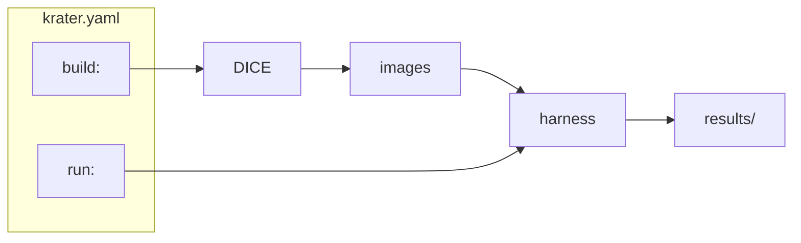

# KRATER
## Kubernetes Runtime Analysis Tool for Empirical Research


## Overview

KRATER benchmarks WebAssembly against native Linux containers on Kubernetes. It builds one workload as native and Wasm images, runs each image in k3s under every runtime that can run it, and records the workload's own metrics alongside the pod's CPU and memory use from cgroup v2. `krater.yaml` describes what to build and how to run it, and DICE, KRATER's SWI-Prolog generator, derives the build from it.



## Quick start

KRATER runs on a single Linux machine with cgroup v2, sudo and k3s, and `make check-deps` checks the tools it needs. [docs/GETTING-STARTED.md](docs/GETTING-STARTED.md) installs the tools and walks through each command.

```bash
make setup-docker   # then reboot
make check-deps
make build-images
make status
make run
```

`make run` starts the short demo in `krater.yaml`, and `make help` lists every target.

## Documentation

| Document | When to read it |
|---|---|
| [docs/GETTING-STARTED.md](docs/GETTING-STARTED.md) | Before the first run. |
| [docs/CONFIGURATION.md](docs/CONFIGURATION.md) | Before editing `krater.yaml`. |
| [docs/RESULTS.md](docs/RESULTS.md) | Before reading a results file. |
| [workloads/README.md](workloads/README.md) | Before benchmarking your own workload. |
| [dice/DICE.md](dice/DICE.md) | Before extending DICE or reading what it generates. |

## Repository layout

* **krater.yaml**: The config.
* **src/**: The Python harness and the C workload runner.
* **dice/**: DICE and the files it generates, in `dice/generated/`.
* **workloads/**: The workloads, one folder each.
* **docs/**: The guides.
* **scripts/**: The scripts the make targets and CI run.

## Licence

GPLv3, see [LICENSE](LICENSE).
