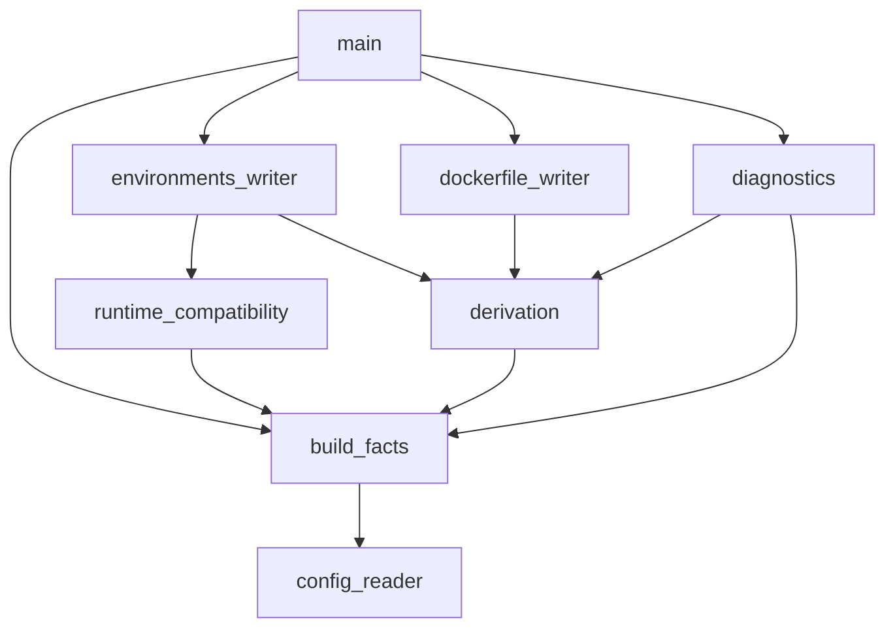

# DICE: Declarative Image Composition Engine

## Overview

DICE is the SWI-Prolog generator behind KRATER's images. It reads the `build` section of `krater.yaml` and derives two files from it:

* **generated/Dockerfile**: One multi-stage build for every target.
* **generated/available_environments.yaml**: Every target paired with each runtime class it may run under, plus the image it runs in.

Nothing is templated. Each stage, base image, command and copied file comes from a rule or a fact table, so a target the rules can't derive is refused.

## Usage

Run from the repository root:

```bash
make dockerfile-generation
```

This runs `swipl dice/main.pl --arch=$(uname -m)`. `--arch` is required and only matters for stages that download a release.

Requires SWI-Prolog with `library(yaml)` and `library(pcre)`. `make check-deps` checks both.

**Tip**: Don't edit `generated/` by hand, edit the YAML then regenerate.

## Configuration

The `build` keys are described in [docs/CONFIGURATION.md](../docs/CONFIGURATION.md).

## Supported builds

| Language | Code format | Toolchain | Builder image |
|---|---|---|---|
| C | native | `gcc` | `gcc:14-trixie` |
| C | wasm | `wasi_sdk` | `ghcr.io/webassembly/wasi-sdk:wasi-sdk-32` |
| Rust | native | `rustc` | `rust:1-slim-trixie` |
| Rust | wasm | `rustc_wasm` | `rust:1-slim-trixie` |

An AOT target adds a `wasmedge` stage, which downloads WasmEdge 0.14.1 for `x86_64` or `aarch64` and compiles the Wasm module ahead of time.

## Outputs

**Dockerfile**: Builder stages come first, one per toolchain and in dependency order. Each target then gets a final stage named after it, which copies a single artifact and runs it as the entrypoint:

* Dynamic native targets run on `debian:trixie-slim`.
* Static native targets and every Wasm target run on `scratch`.

**available_environments.yaml**: One entry per target and runtime class. The image is `krater:<workload>_<target>`, e.g. `krater:matmul_native`.

* `native` runs under `default`.
* `wasm` runs under `wasmtime`, `wasmedge` and `wasmer`.
* `wasm` with `aot_compiler: wasmedge` runs only under `wasmedge`.

## Refusals

When a config can't be derived, DICE explains why and leaves the generated files untouched. For example:

```
cannot derive a Dockerfile:
  target static and static-too build the same artifact
```

Each cause gets its own line. If none of the known causes match, DICE says that too.

## Extending

Each extension is a set of fact rows. Then run `make dockerfile-generation`, which names most missing rows.

| Extension | File | Fact rows | Notes |
|---|---|---|---|
| Language | `derivation.pl` | One `language_toolchain` per code format. Per new toolchain: `builder_image`, `toolchain_binary`, `optimization_syntax`, `stage_setup`, plus `toolchain_flag` and `modifier_flag` if it uses them. | To run as a workload, it also needs a runner, named in `language_runner`. |
| AOT compiler | `derivation.pl`, `runtime_compatibility.pl` | `toolchain_supports(<wasm toolchain>, aot_compiler, <compiler>)`, the compiler's own toolchain rows, and `aot_runtime` naming the runtime class that runs its output. A downloaded compiler also needs `toolchain_release`, `toolchain_asset`, `toolchain_archive` and `toolchain_url`. | `aot_runtime` is what pairs the target with its runtime. The compile command follows WasmEdge's `compile` form. |
| Wasm runtime | `runtime_compatibility.pl` | `wasm_shim` | The shim also goes in `scripts/setup-wasm.sh`, `teardown-wasm.sh` and `check-deps.sh`, and its name in `run.runtimes`. k3s creates a RuntimeClass for the shims it detects, check with `kubectl get runtimeclass`. |
| Architecture | `derivation.pl` | `toolchain_asset` for every downloaded toolchain. | `make` passes `uname -m` as `--arch`. The builder images and shims need a build for it too. |

## Modules

* **main.pl**: Reads the options, loads the facts, calls both writers, and turns a refusal into a message and exit code 1.
* **config_reader.pl**: Reads and validates the `build` section of `krater.yaml` and returns the facts.
* **build_facts.pl**: Holds the facts.
* **derivation.pl**: Derives the toolchains, steps, stage order, filenames and image names.
* **runtime_compatibility.pl**: Pairs each target with the runtime classes it may run under.
* **dockerfile_writer.pl**: Renders the Dockerfile.
* **environments_writer.pl**: Renders the environments file.
* **diagnostics.pl**: Explains a refusal once a derivation has failed.

Only `main.pl` halts and only `build_facts.pl` asserts. Each writer is the only module that knows its file's syntax.


