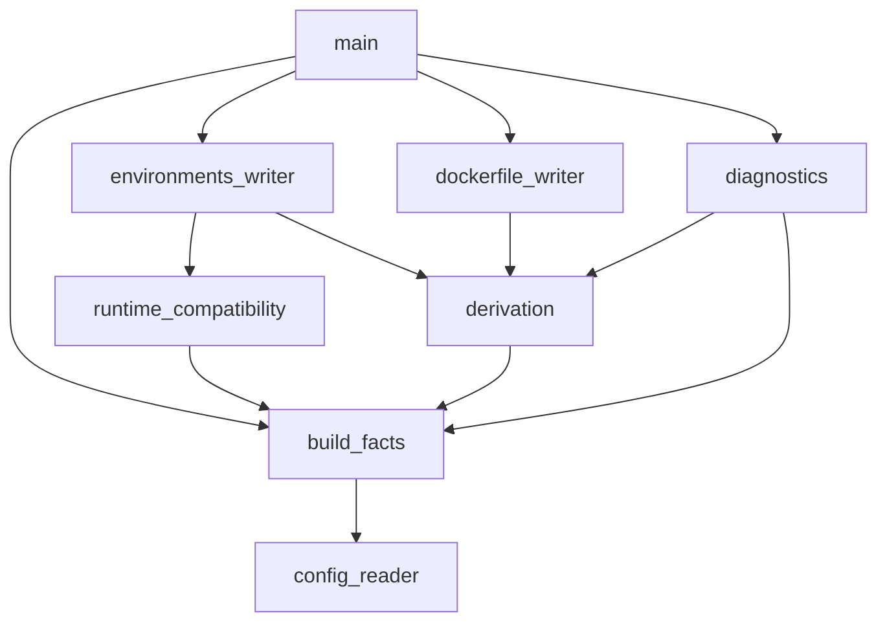

# DICE: Declarative Image Composition Engine

## Overview

DICE is the SWI-Prolog generator behind KRATER's images. It reads `build.yaml` and derives two files from it:

* **generated/Dockerfile**: One multi-stage build for every target.
* **generated/available_environments.yaml**: Every target paired with each runtime class it may run under, plus the image it runs in.

Nothing is templated. Each stage, base image, command and copied file comes from a rule or a fact table, so a target the rules can't derive is refused.

## Usage

Run from the repository root:

```bash
make dockerfile-generation
```

This runs `swipl dice/main.pl --arch=$(uname -m)`. `--arch` is required and only matters for stages that download a release.

Requires SWI-Prolog with `library(yaml)` and `library(pcre)`. `make check-deps` checks both.

**Tip**: Don't edit `generated/` by hand, edit the YAML then regenerate.

## Configuration

```yaml
# build.yaml
workload:
  language: c
  source: workloads/matmul/matmul.c

build:
  optimization_level: 3

targets:
  - name: native
    code_format: native
    link_mode: dynamic

  - name: native-static
    code_format: native
    link_mode: static

  - name: wasm
    code_format: wasm

  - name: wasm-aot
    code_format: wasm
    aot_compiler: wasmedge
```

* `workload.language`: `c` or `rust`.
* `workload.source`: A relative path. Its filename without the extension names every artifact and image.
* `build.optimization_level`: `0` to `3`, translated into each toolchain's own flag syntax.
* `targets`: A non-empty list. Every target needs a unique `name` and a `code_format`.
  * `name`: Lowercase letters and digits, separated by `.`, `_`, `__` or `-`.
  * `code_format`: `native` or `wasm`.
  * `link_mode`: `dynamic` or `static`. Required for `native`, refused for `wasm`.
  * `aot_compiler`: `wasmedge`. Only for a C `wasm` target.

Unknown/missing keys and malformed/misshapen values are refused, with the offending key named.

## Supported builds

| Language | Code format | Toolchain | Builder image |
|---|---|---|---|
| C | native | `gcc` | `gcc:14-trixie` |
| C | wasm | `wasi_sdk` | `ghcr.io/webassembly/wasi-sdk:wasi-sdk-32` |
| Rust | native | `rustc` | `rust:1-slim-trixie` |
| Rust | wasm | `rustc_wasm` | `rust:1-slim-trixie` |

An AOT target adds a `wasmedge` stage, which downloads WasmEdge 0.14.1 for `x86_64` or `aarch64` and compiles the Wasm module ahead of time.

## Outputs

**Dockerfile**: Builder stages come first, one per toolchain and in dependency order. Each target then gets a final stage named after it, which copies a single artifact and runs it as the entrypoint:

* Dynamic native targets run on `debian:trixie-slim`.
* Static native targets and every Wasm target run on `scratch`.

**available_environments.yaml**: One entry per target and runtime class. The image is `krater:<workload>_<target>`, e.g. `krater:matmul_native`.

* `native` runs under `default`.
* `wasm` runs under `wasmtime`, `wasmedge` and `wasmer`.
* `wasm` with `aot_compiler: wasmedge` runs only under `wasmedge`.

## Refusals

When a config can't be derived, DICE explains why and leaves the generated files untouched. For example:

```
cannot derive a Dockerfile:
  target static and static-too build the same artifact
```

Each cause gets its own line. If none of the known causes match, DICE says that too.

## Modules

* **main.pl**: Reads the options, loads the facts, calls both writers, and turns a refusal into a message and exit code 1.
* **config_reader.pl**: Reads and validates `build.yaml` and returns the facts.
* **build_facts.pl**: Holds the facts.
* **derivation.pl**: Derives the toolchains, steps, stage order, filenames and image names.
* **runtime_compatibility.pl**: Pairs each target with the runtime classes it may run under.
* **dockerfile_writer.pl**: Renders the Dockerfile.
* **environments_writer.pl**: Renders the environments file.
* **diagnostics.pl**: Explains a refusal once a derivation has failed.

Only `main.pl` halts and only `build_facts.pl` asserts. Each writer is the only module that knows its file's syntax.


